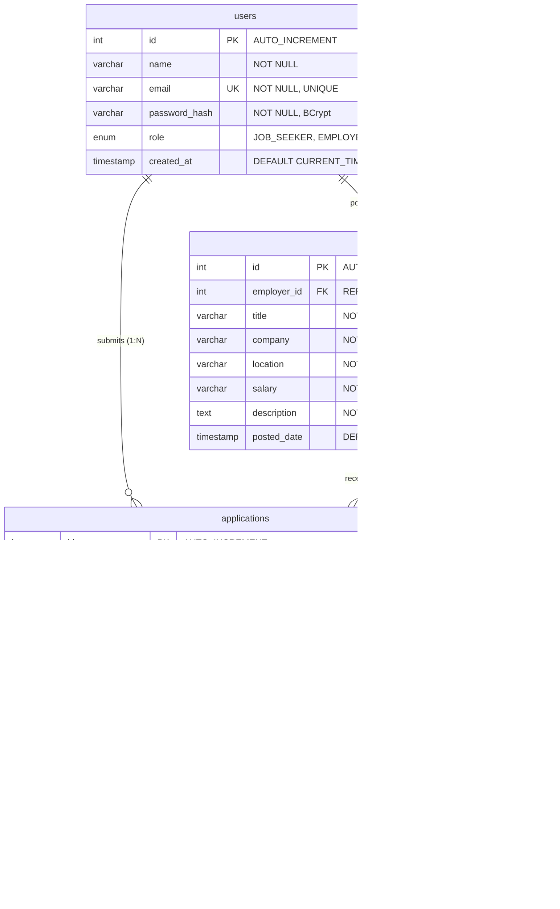

# Job Portal Management System using Java and MySQL

A complete, beginner-friendly College Course Based Project (CBP) / Capstone Project built with **Java Servlets**, **JSP**, **JDBC**, **MySQL**, and **Apache Tomcat 10.1**, styled with **Bootstrap 5**, and managed via **Maven**.

---

## 🎯 Project Overview

The **Job Portal Management System** bridges the gap between hiring employers and job seekers. Employers can publish job openings, review candidate applicants, and manage recruitment decisions by updating candidate status to **SHORTLISTED** or **REJECTED**. Job seekers can discover vacancies, apply with a single click, track real-time application decisions, and avoid duplicate applications through strict database constraints.

### Mandatory Technologies Used
- **Backend / Web Layer**: Java Servlets 6.0 & JSP 3.1 (Jakarta EE 10 namespace: `jakarta.servlet.*`)
- **Persistence Layer**: JDBC (Java Database Connectivity) with `PreparedStatement`
- **Database**: MySQL 8.0+ (`InnoDB` engine, foreign keys, unique constraints, status ENUM)
- **Application Server**: Apache Tomcat 10.1
- **UI / Frontend**: HTML5, CSS3, Bootstrap 5.3 (Responsive Design)
- **Security**: BCrypt salted password hashing (`org.mindrot:jbcrypt`), HTTP Session management, `AuthFilter` role enforcement
- **Build Tool**: Apache Maven

> ⚠️ **Strict Constraint Adherence**: Does **not** use Node.js, Express, MongoDB, React, or unnecessary frameworks. Fully native Java EE / Jakarta EE MVC.

---

## 🚀 Key Features

1. **User Authentication & Role-Based Access Control**:
   - Secure registration and login for two distinct roles: **`JOB_SEEKER`** and **`EMPLOYER`**.
   - Salted password encryption using **BCrypt** with 12 rounds. Incorrect passwords are categorically rejected.
   - Server-side route protection via `AuthFilter` defending `/employer/*`, `/seeker/*`, and `/admin/*`.
   - Complete session termination upon logout with no-cache response headers.
2. **Dynamic Job Discovery & Search**:
   - Live job listings on the Home Page sorted by latest posting date.
   - Real-time search filters by keyword (title/company/skills) and location.
3. **Job Seeker Application Workflow & Comprehensive Questionnaire**:
   - Required **Section A: Personal Information**: Full Name, Email Address, Mobile Number (10+ digits validated), Current Location. Pre-filled from profile when available and editable.
   - Required **Section B: Interview Questions**:
     1. *Why should we hire you?* (multiline text).
     2. *Do you have work experience?* (Yes/No toggle). If Yes, prompts for relevant experience and years of experience; if No, allows identification as fresher with academic project experience.
     3. *What are your salary expectations?* (numerical CTC or "Negotiable").
     4. *Why do you want this job?* (multiline text).
   - Required **Section C: Resume Upload**: Supports PDF, DOC, and DOCX up to 5 MB with strict server-side validation and path-traversal prevention.
   - **Database-enforced Duplicate Prevention**: Seeker cannot apply twice to the same job (`CONSTRAINT unique_job_seeker UNIQUE (job_id, seeker_id)`).
   - **Seeker Dashboard ("My Applications")**: Candidate can review their submitted questionnaire responses via an interactive modal, monitor real-time review status (**⏳ Under Review**, **🎉 Shortlisted**, **❌ Not Selected**), and download their uploaded resume.
4. **Employer Portal & Applicant Review**:
   - Form to publish new job openings (Title, Company, Location, Salary, Full Description).
   - Employer dashboard displaying all posted jobs and applicant counts.
   - Candidate inspection page showing applicant names, emails, phones, and application timestamps.
   - **Questionnaire Inspection**: Employers can click "📋 Answers" to view the complete questionnaire submitted by any candidate.
   - **Secure Resume Access**: Employers can download resumes only for applications submitted to jobs they own (`HTTP 403 Forbidden` enforced on non-owners).
   - **Application Status Updates**: Employer can update any candidate's status to **`SHORTLISTED`** or **`REJECTED`**.
   - **Strict Ownership Verification**: Only the employer who posted the job has authorization to modify its applications or download resumes.

---

## 🗄️ Database Schema Design

The system adheres strictly to the **3 core tables** specification with relational integrity:



- **Constraint Highlight 1**: `CONSTRAINT unique_job_seeker UNIQUE (job_id, seeker_id)` guarantees at the database level that no candidate can apply to the same job multiple times.
- **Constraint Highlight 2**: `FOREIGN KEY (employer_id) REFERENCES users(id) ON DELETE CASCADE` automatically maintains referential integrity if user accounts are removed.

---

## 📂 Project Architecture (MVC Pattern)

```text
c:\JobPortalManagementSystem\
├── pom.xml                                   # Maven project configuration
├── README.md                                 # Setup guide and documentation
├── database\
│   └── schema.sql                            # MySQL schema creation and seed data
├── src\
│   ├── main\
│   │   ├── java\com\jobportal\
│   │   │   ├── model\                        # Model Layer (POJOs)
│   │   │   │   ├── User.java
│   │   │   │   ├── Job.java
│   │   │   │   └── Application.java
│   │   │   ├── dao\                          # DAO Layer (JDBC Prepared Statements)
│   │   │   │   ├── UserDAO.java
│   │   │   │   ├── JobDAO.java
│   │   │   │   └── ApplicationDAO.java
│   │   │   ├── util\                         # Utilities
│   │   │   │   ├── DBConnection.java         # JDBC connection loader (decoupled)
│   │   │   │   └── PasswordUtil.java         # BCrypt hashing & checking
│   │   │   └── servlet\                      # Controller Layer (Jakarta Servlets)
│   │   │       ├── AuthFilter.java           # Route security filter (/employer/*, /seeker/*, /admin/*)
│   │   │       ├── HomeServlet.java          # Job search & home controller
│   │   │       ├── LoginServlet.java         # Authentication controller
│   │   │       ├── RegisterServlet.java      # Registration controller
│   │   │       ├── LogoutServlet.java        # Session termination
│   │   │       ├── JobDetailsServlet.java    # Individual job view
│   │   │       ├── PostJobServlet.java       # Employer job creation
│   │   │       ├── MyJobsServlet.java        # Employer posted jobs list
│   │   │       ├── ViewApplicantsServlet.java# Employer applicant inspection & status actions
│   │   │       ├── UpdateApplicationStatusServlet.java # Status updates (Shortlist/Reject)
│   │   │       ├── ApplyJobServlet.java      # Seeker application submission
│   │   │       └── MyApplicationsServlet.java# Seeker application history
│   │   ├── resources\
│   │   │   └── db.properties                 # External database credentials
│   │   └── webapp\                           # View Layer (JSP & UI Assets)
│   │       ├── WEB-INF\web.xml               # Jakarta deployment descriptor
│   │       ├── css\style.css                 # Custom styles
│   │       ├── includes\
│   │       │   ├── navbar.jsp                # Role-sensitive navigation bar
│   │       │   ├── footer.jsp                # Standardized footer
│   │       │   └── alerts.jsp                # Reusable notification toasts
│   │       ├── index.jsp                     # Home page
│   │       ├── login.jsp                     # Login screen with quick credentials helper
│   │       ├── register.jsp                  # Registration screen with role selection
│   │       ├── job-details.jsp               # Full job descriptions
│   │       ├── employer\
│   │       │   ├── post-job.jsp              # Post job form
│   │       │   ├── my-jobs.jsp               # Employer dashboard
│   │       │   └── view-applicants.jsp       # Candidate list with Shortlist/Reject controls
│   │       └── seeker\
│   │           └── my-applications.jsp       # Seeker dashboard with dynamic status badges
│   └── test\
│       ├── java\com\jobportal\               # Automated JUnit 5 test suite (12 test cases)
│       │   ├── PasswordUtilTest.java
│       │   └── DAOTest.java
│       ├── test_e2e.ps1                      # Automated HTTP end-to-end test
│       └── test_all_features.ps1             # Full security & status verification test
└── docs\
    ├── screenshots\                          # Genuine full-page PNG screenshots
    └── CBP_PROJECT_REPORT.md                 # Formal college project report
```

---

## ⚙️ Setup and Installation Guide

### Step 1: Clone / Navigate to Project Directory
```powershell
cd C:\JobPortalManagementSystem
```

### Step 2: Database Configuration
1. Ensure your MySQL 8.0 service is running.
2. Import the schema script:
   ```powershell
   Get-Content database/schema.sql -Raw | mysql -u root -p
   ```
3. Update your database credentials in `src/main/resources/db.properties`:
   ```properties
   db.url=jdbc:mysql://localhost:3306/job_portal?useSSL=false&allowPublicKeyRetrieval=true&serverTimezone=UTC
   db.user=root
   db.password=YOUR_MYSQL_PASSWORD
   ```
   *(Alternatively, set environment variables `DB_USER` and `DB_PASSWORD` without touching files!)*

### Step 3: Build WAR with Maven
```powershell
mvn clean package
```
This produces `target/jobportal.war`.

### Step 4: Deploy to Apache Tomcat 10.1
Copy `jobportal.war` and exploded directory into Tomcat's `webapps` folder:
```powershell
Copy-Item target/jobportal.war C:\apache-tomcat-10.1.36\apache-tomcat-10.1.36\webapps\ -Force
Copy-Item -Path "target\jobportal\*" -Destination "C:\apache-tomcat-10.1.36\apache-tomcat-10.1.36\webapps\jobportal\" -Recurse -Force
```
Start Tomcat if it is not already running:
```powershell
C:\apache-tomcat-10.1.36\apache-tomcat-10.1.36\bin\catalina.bat run
```

### Step 5: Access the Web Application
Open your browser and navigate to:
**[http://localhost:8080/jobportal/](http://localhost:8080/jobportal/)**

---

## 🔑 Pre-Configured Demo Accounts (For Viva / Testing)

| Role | Email Address | Password | Purpose |
| :--- | :--- | :--- | :--- |
| **Employer** | `employer@portal.com` | `password123` | Post jobs, review applicants, Shortlist / Reject candidates |
| **Job Seeker** | `seeker@portal.com` | `password123` | Browse jobs, apply, monitor application status |

*(You can also register brand-new accounts through the web interface at any time!)*

---

## 🧪 Testing & Verification

### 1. Automated JUnit 5 Test Suite (15 Tests)
Run the automated test suite:
```powershell
mvn test
```
**Results**: **15 out of 15 tests passed (0 failures, 0 errors)**:
- BCrypt salted hashing and verification
- User registration and unique email checks
- Password authentication & incorrect password rejection
- Employer job posting
- Job search & keyword filtering
- Seeker application with questionnaire & duplicate rejection
- Seeker and employer query joins with questionnaire & resume data
- Pre-configured demo account verification
- Employer application status update (`SHORTLISTED` / `REJECTED`)
- Ownership security verification (unauthorized employer rejected from viewing candidate questionnaire or resume)
- Seeker ownership verification (candidates can only view their own applications)
- Resume file format and size validation boundary tests (PDF, DOC, DOCX up to 5 MB)
- Role verification helpers

### 2. Live HTTP Integration & Security Test
Execute the automated end-to-end security test against live Tomcat:
```powershell
powershell -ExecutionPolicy Bypass -File src/test/test_all_features.ps1
```
**Results**: All checks passed:
- Incorrect password strictly rejected
- Employer demo account login & dashboard
- Seeker demo account login & home page
- Status update to `SHORTLISTED` verified in MySQL and on Seeker dashboard
- Status update to `REJECTED` verified in MySQL and on Seeker dashboard
- Unauthorized seeker blocked from status update
- Server-side route security: Employer blocked from `/seeker/*`, Seeker blocked from `/employer/*`, All blocked from `/admin/*`
- Session invalidation on logout verified

---

## 📋 Manual Verification Steps (For Examiner / Evaluator)

1. **Verify Job Listing & Search**:
   - Open [http://localhost:8080/jobportal/home](http://localhost:8080/jobportal/home).
   - Enter keyword "Architect" and click "Search" to see filtered results.
2. **Verify Employer Status Update**:
   - Sign In as Employer (`employer@portal.com` / `password123`).
   - Navigate to "My Posted Jobs" -> click "View Applicants" on any job.
   - Click the green **Shortlist** button. Notice the alert toast and status badge changes to "✓ Shortlisted".
   - Click the red **Reject** button. Notice the status badge changes to "✗ Rejected".
3. **Verify Job Seeker Real-Time Status View**:
   - Click "Logout", then Sign In as Job Seeker (`seeker@portal.com` / `password123`).
   - Navigate to "My Applications" ([http://localhost:8080/jobportal/seeker/my-applications](http://localhost:8080/jobportal/seeker/my-applications)).
   - Observe the updated status badge matching the employer's decision.
4. **Verify Role Security**:
   - While logged in as Job Seeker, attempt to navigate to [http://localhost:8080/jobportal/employer/my-jobs](http://localhost:8080/jobportal/employer/my-jobs).
   - Verify the server immediately redirects to Home with: `Access denied: Employer privileges required.`
5. **Verify Logout**:
   - Click "Logout".
   - Click the browser Back button or navigate to [http://localhost:8080/jobportal/seeker/my-applications](http://localhost:8080/jobportal/seeker/my-applications).
   - Verify the server redirects to Login with: `Please log in to access this page.`
