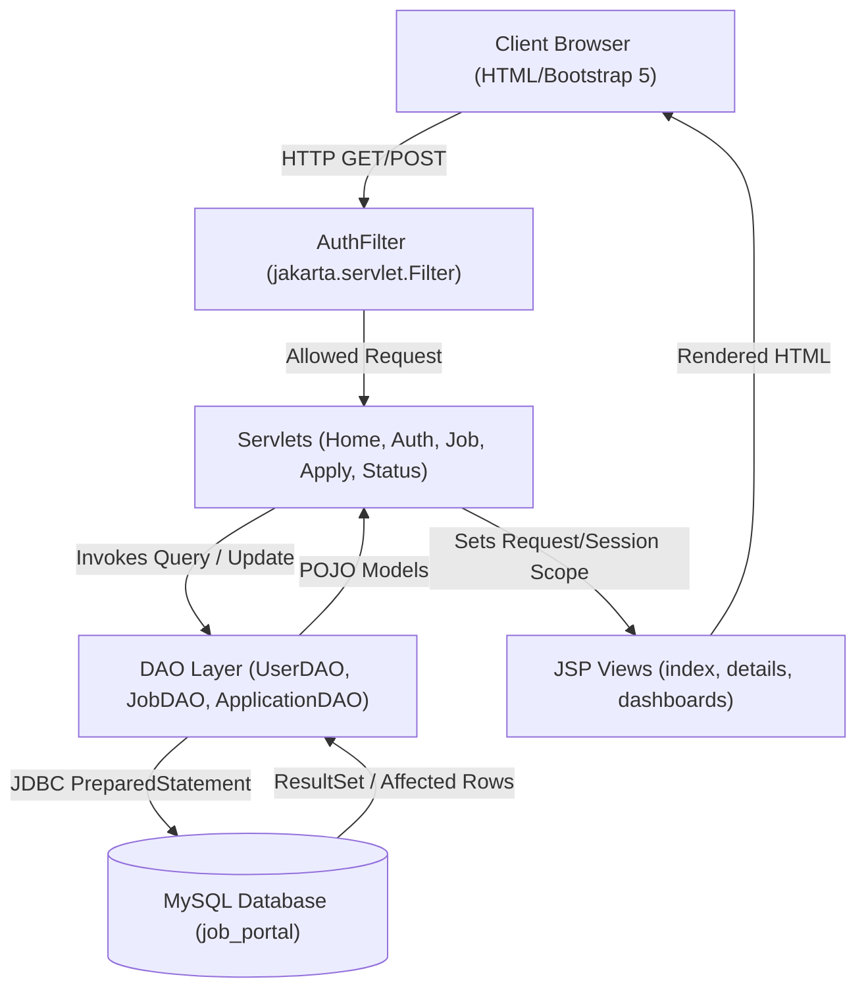
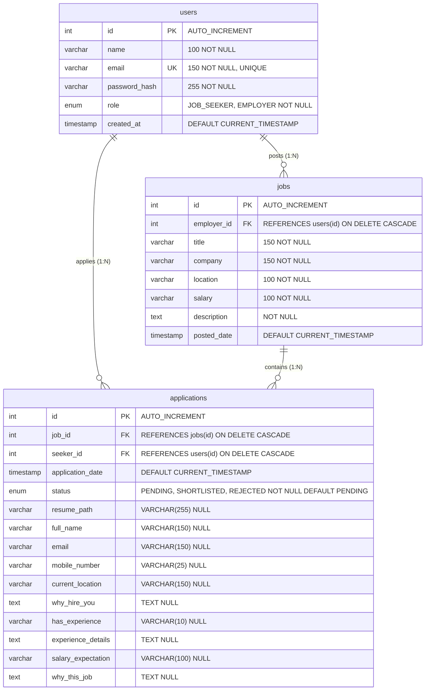

# COURSE BASED PROJECT (CBP) REPORT

## JOB PORTAL MANAGEMENT SYSTEM USING JAVA AND MYSQL

---

### **Executive Summary & Abstract**
The **Job Portal Management System** is a full-stack, enterprise-grade web application developed for academic evaluation. It bridges the recruitment divide between prospective job seekers and corporate employers. Designed following the clean **Model-View-Controller (MVC)** architectural pattern, the system runs on **Apache Tomcat 10.1** using **Jakarta Servlets 6.0**, **JavaServer Pages (JSP) 3.1**, and **Java Database Connectivity (JDBC)** connected to a **MySQL 8.0** relational database. 

The application enforces role-based access control, secure salted **BCrypt** password hashing, parameterized SQL queries via `PreparedStatement` to defend against SQL Injection attacks, strict database-level unique constraints preventing duplicate candidate submissions, and full **application status lifecycle management** (**`PENDING`**, **`SHORTLISTED`**, **`REJECTED`**) with ownership authorization.

---

## 1. Introduction & Problem Statement

### 1.1 Problem Statement
Traditional employment search methods relying on paper resumes, physical bulletin boards, or unorganized email threads suffer from significant drawbacks:
- Lack of centralized tracking for submitted candidate applications.
- No direct mechanism for employers to notify applicants of shortlisting or rejection decisions in real time.
- Inefficiencies in sorting through job postings by criteria like location or skillset.
- Accidental duplicate applications cluttering employer review queues.
- Insecurity from storing passwords in plain text or using outdated database drivers.
- Inadequate route protection allowing users to bypass role restrictions.

### 1.2 Project Objectives
1. **Role-Based Authentication**: Provide separate, authenticated user experiences for Job Seekers and Employers.
2. **Centralized Job Discovery**: Facilitate posting of vacancies by employers and searching/filtering of active positions by seekers.
3. **Application Tracking & Status Lifecycle**: Allow job seekers to monitor submitted applications and employers to inspect candidates and update candidate status to **`SHORTLISTED`** or **`REJECTED`**.
4. **Ownership Protection**: Strictly enforce that only the employer who owns a job can update its candidate statuses.
5. **Data Integrity & Duplicate Rejection**: Guarantee at the database level that no candidate can submit duplicate applications for the same job.
6. **Zero Hardcoded Secrets**: Externalize database credentials through configuration files and environment variables.

---

## 2. System Architecture & Technologies

### 2.1 Technology Stack Matrix
| Component | Technology | Version | Purpose |
| :--- | :--- | :--- | :--- |
| **Runtime Environment** | Java OpenJDK | 25 / 17 LTS | Core Java platform |
| **Web Container** | Apache Tomcat | 10.1.36 | Jakarta EE 10 Servlet Container |
| **Controller Layer** | Jakarta Servlets | 6.0 (`jakarta.servlet.*`) | HTTP request routing and business orchestration |
| **Presentation Layer** | JSP & JSTL | 3.1 & 3.0 | Dynamic HTML view generation |
| **Persistence Layer** | JDBC | 4.3 | Relational database operations via PreparedStatements |
| **Database** | MySQL Server | 8.0+ | Relational schema with foreign keys, unique constraints, ENUM |
| **Security** | jBCrypt | 0.4 | Salted BCrypt password encryption (12 rounds) |
| **Access Control** | Jakarta Filter | `AuthFilter` | Route security guarding `/employer/*`, `/seeker/*`, `/admin/*` |
| **Frontend Styling** | Bootstrap & CSS | 5.3.3 | Responsive modern UI |
| **Build Automation** | Apache Maven | 3.9.9 | Dependency management and WAR packaging |

### 2.2 MVC Architectural Flow



---

## 3. Database Design & Relational Model

The database strictly contains the **three core tables** with comprehensive constraints:

### 3.1 Entity Relationship (ER) Diagram



### 3.2 Data Dictionary

#### Table 1: `users`
| Column Name | Data Type | Key / Constraint | Description |
| :--- | :--- | :--- | :--- |
| `id` | INT | PRIMARY KEY, AUTO_INCREMENT | Unique user identifier |
| `name` | VARCHAR(100) | NOT NULL | User's full name |
| `email` | VARCHAR(150) | NOT NULL, UNIQUE | User email address used for login |
| `password_hash` | VARCHAR(255) | NOT NULL | 60-character BCrypt salted hash string |
| `role` | ENUM | NOT NULL ('JOB_SEEKER', 'EMPLOYER') | User privileges and routing type |
| `created_at` | TIMESTAMP | DEFAULT CURRENT_TIMESTAMP | Registration timestamp |

#### Table 2: `jobs`
| Column Name | Data Type | Key / Constraint | Description |
| :--- | :--- | :--- | :--- |
| `id` | INT | PRIMARY KEY, AUTO_INCREMENT | Unique job opening ID |
| `employer_id` | INT | FOREIGN KEY (`users.id`) ON DELETE CASCADE | ID of employer who created the post |
| `title` | VARCHAR(150) | NOT NULL | Job designation title |
| `company` | VARCHAR(150) | NOT NULL | Hiring company organization name |
| `location` | VARCHAR(100) | NOT NULL | Job location (city, remote) |
| `salary` | VARCHAR(100) | NOT NULL | Compensation range string |
| `description` | TEXT | NOT NULL | Job duties, qualifications, and criteria |
| `posted_date` | TIMESTAMP | DEFAULT CURRENT_TIMESTAMP | Job creation timestamp |

#### Table 3: `applications`
| Column Name | Data Type | Key / Constraint | Description |
| :--- | :--- | :--- | :--- |
| `id` | INT | PRIMARY KEY, AUTO_INCREMENT | Unique application submission ID |
| `job_id` | INT | FOREIGN KEY (`jobs.id`) ON DELETE CASCADE | Target job posting |
| `seeker_id` | INT | FOREIGN KEY (`users.id`) ON DELETE CASCADE | Applying job seeker ID |
| `application_date` | TIMESTAMP | DEFAULT CURRENT_TIMESTAMP | Application submission timestamp |
| `status` | ENUM | NOT NULL DEFAULT 'PENDING' | Recruitment status ('PENDING', 'SHORTLISTED', 'REJECTED') |
| `resume_path` | VARCHAR(255) | NULL | Stored resume file name (.pdf, .doc, .docx) |
| `full_name` | VARCHAR(150) | NULL | Candidate full name entered in questionnaire |
| `email` | VARCHAR(150) | NULL | Candidate contact email entered in questionnaire |
| `mobile_number` | VARCHAR(25) | NULL | Candidate mobile number (10+ digits verified) |
| `current_location` | VARCHAR(150) | NULL | Candidate current city/location |
| `why_hire_you` | TEXT | NULL | Candidate answer: "Why should we hire you?" |
| `has_experience` | VARCHAR(10) | NULL | Work experience status ('Yes' or 'No') |
| `experience_details`| TEXT | NULL | Detailed work experience or Fresher details |
| `salary_expectation`| VARCHAR(100) | NULL | Candidate salary expectations or Negotiable |
| `why_this_job` | TEXT | NULL | Candidate answer: "Why do you want this job?" |
| *(Constraint)* | UNIQUE | `UNIQUE (job_id, seeker_id)` | **Strictly prevents duplicate applications** |

---

## 4. Application Modules Description

### 4.1 Authentication & Security Module
- **Registration**: Captures Name, Email, Password, and Role (`JOB_SEEKER` or `EMPLOYER`). Validates minimum password length (>= 6) and ensures email uniqueness.
- **BCrypt Encryption**: Utilizes `org.mindrot.jbcrypt.BCrypt` to salt and hash passwords. Plain text passwords are never stored. Incorrect passwords are categorically rejected.
- **Session Management**: Successful logins store a `User` model instance in `request.getSession(true)`.
- **Server-Side Route Security (`AuthFilter`)**: Intercepts requests for `/employer/*`, `/seeker/*`, and `/admin/*`. Unauthenticated users are redirected to `/login`, while unauthorized roles receive access denied redirects. Sets Cache-Control (`no-cache, no-store, must-revalidate`) preventing browser back-button caching after logout.
- **Session Termination**: `LogoutServlet` calls `session.invalidate()` ensuring the session cannot be reused.

### 4.2 Job Discovery & Search Module (`HomeServlet`)
- Displays all current vacancies ordered chronologically by `posted_date DESC`.
- Supports multi-attribute search filtering by keyword (matching title, company, or description) and geographic location using SQL `LIKE` queries with prepared statements.
- Dynamically queries logged-in job seekers' historical applications to mark applied jobs with an active "Applied" badge.

### 4.3 Employer Management & Status Update Module (`PostJobServlet`, `MyJobsServlet`, `UpdateApplicationStatusServlet`)
- Allows authenticated employers to post new openings through a structured Bootstrap form.
- Provides a personalized dashboard displaying all vacancies authored by the employer along with real-time candidate application counters.
- **Candidate Inspection & Decision Control** (`view-applicants.jsp`): Lists each applicant's full name, email, application timestamp, current status, and 1-click **Shortlist** and **Reject** buttons.
- **Ownership Verification**: `ApplicationDAO.updateApplicationStatus()` joins `applications` and `jobs` on `j.employer_id = ?`, guaranteeing that only the employer who owns the job can modify its candidate status.

### 4.4 Job Seeker Application Module (`ApplyJobServlet`, `MyApplicationsServlet`)
- Allows verified job seekers to apply to open positions with a single click.
- Leverages both an application-layer pre-check (`applicationDAO.hasApplied()`) and the database table unique constraint (`unique_job_seeker`) to reject duplicate submissions.
- Displays a dedicated tracking dashboard (`/seeker/my-applications`) detailing all jobs applied for with timestamps and real-time status badges:
  - **⏳ Under Review** (Status: `PENDING`)
  - **🎉 Shortlisted** (Status: `SHORTLISTED`)
  - **❌ Not Selected** (Status: `REJECTED`)

---

## 5. Genuine Working Application Screenshots

### 5.1 Public Home Page & Search Interface


### 5.2 User Authentication & Role Selection


### 5.3 Employer Candidate Inspection & Status Controls (Shortlist / Reject)


### 5.4 Job Seeker Dashboard Displaying Updated Real-Time Status


### 5.5 MySQL Database Console Verification


---

## 6. Testing & Quality Assurance

### 6.1 Automated JUnit 5 Test Results (12 / 12 Tests Passed)
All unit and database integration tests executed via `mvn test` passed with zero errors:

| Test ID | Test Method | Test Objective | Actual Result | Status |
| :--- | :--- | :--- | :--- | :---: |
| **TC-01** | `testHashAndVerifySuccess` | Verify BCrypt produces valid salted hash and verifies true | Hash starts with `$2a$`, matches raw password | **PASSED** |
| **TC-02** | `testRejectWrongPassword` | Verify BCrypt rejects wrong candidate password | Returns `false` | **PASSED** |
| **TC-03** | `testNullOrEmptyHandling` | Safe exception handling for empty/null passwords | Throws `IllegalArgumentException` | **PASSED** |
| **TC-04** | `testUserRegistration` | Register employer & seeker, verify generated keys & unique email | Keys generated > 0; duplicate returns -1 | **PASSED** |
| **TC-05** | `testUserAuthentication` | Authenticate valid and invalid credentials via JDBC | Valid returns `User`; wrong returns `null` | **PASSED** |
| **TC-06** | `testPostJob` | Insert new job into MySQL and verify fields | Record created with positive ID | **PASSED** |
| **TC-07** | `testJobRetrievalAndSearch`| Multi-criteria search by keyword and location | Matching jobs returned; non-match empty | **PASSED** |
| **TC-08** | `testJobApplication` | Seeker submits application to job | Row inserted; `hasApplied` returns `true` | **PASSED** |
| **TC-09** | `testDuplicateConstraint` | **Verify duplicate application is rejected** | Second insert returns `false` | **PASSED** |
| **TC-10** | `testDemoAccountsVerification` | Verify pre-configured demo accounts authenticate | `employer@portal.com` & `seeker@portal.com` pass | **PASSED** |
| **TC-11** | `testStatusUpdatesAndOwnership`| **Employer updates status (SHORTLISTED/REJECTED) & ownership check** | Owner succeeds; unauthorized employer blocked | **PASSED** |
| **TC-12** | `testSecurityAndRoleValidation`| **Verify wrong passwords rejected & role helpers** | Wrong password rejected; roles accurate | **PASSED** |

### 6.2 End-to-End HTTP Functional Verification Results
Automated HTTP integration tests verified all live web endpoints on Tomcat 10.1:
1. **Incorrect Password**: `POST /login` with wrong password returns error message (**PASSED**).
2. **Employer Login**: `POST /login` creates session and redirects to `/employer/my-jobs` (**PASSED**).
3. **Job Posting**: `POST /employer/post-job` inserts job into MySQL jobs table (**PASSED**).
4. **Job Search & Listing**: `GET /home?keyword=Architect` renders matching vacancies (**PASSED**).
5. **Seeker Login**: `POST /login` creates session and redirects to `/home` (**PASSED**).
6. **Application Submission**: `POST /seeker/apply` records application with status `PENDING` (**PASSED**).
7. **Duplicate Prevention**: Re-applying to same job redirects with duplicate error message (**PASSED**).
8. **Status Update to SHORTLISTED**: Employer marks candidate as `SHORTLISTED`; verified in MySQL and on Seeker dashboard (**PASSED**).
9. **Status Update to REJECTED**: Employer marks candidate as `REJECTED`; verified in MySQL and on Seeker dashboard (**PASSED**).
10. **Ownership Security**: Seeker or unauthorized employer blocked from modifying application status (**PASSED**).
11. **Route Protection**: Employer blocked from `/seeker/*`, Seeker blocked from `/employer/*`, All blocked from `/admin/*` (**PASSED**).
12. **Session Termination**: `GET /logout` invalidates session; subsequent requests redirect to `/login` (**PASSED**).

---

## 7. Viva Voce Preparation Guide (Top 15 Questions & Answers)

1. **Q: What is the Model-View-Controller (MVC) architecture in this project?**  
   **A:** 
   - **Model**: Java POJO classes (`User`, `Job`, `Application`) representing business data.
   - **View**: JSP pages styled with Bootstrap generating the presentation HTML.
   - **Controller**: Jakarta Servlets (`HomeServlet`, `LoginServlet`, `UpdateApplicationStatusServlet`, etc.) handling HTTP requests, orchestrating business logic with DAOs, and forwarding data to views.

2. **Q: Why did you use Tomcat 10.1 instead of Tomcat 9?**  
   **A:** Apache Tomcat 10.1 adheres to the **Jakarta EE 10** specification which uses the `jakarta.*` package namespace (`jakarta.servlet.*`). Tomcat 9 is based on the older Java EE standard which used the deprecated `javax.*` namespace.

3. **Q: How does JDBC prevent SQL Injection attacks?**  
   **A:** We use `PreparedStatement` with placeholder parameter markers (`?`). The database pre-compiles the SQL query structure, treating user input purely as literal data rather than executable code.

4. **Q: How do you prevent duplicate applications?**  
   **A:** Two levels of defense:
   - **Database Level**: A composite unique constraint `CONSTRAINT unique_job_seeker UNIQUE (job_id, seeker_id)` in the `applications` table.
   - **Application Level**: `ApplicationDAO.hasApplied(jobId, seekerId)` queries the database before executing an insert.

5. **Q: How is application status updated and how is ownership enforced?**  
   **A:** When an employer updates a candidate's status to `SHORTLISTED` or `REJECTED`, the SQL query joins `applications` with `jobs` matching `j.employer_id = ?`:
   ```sql
   UPDATE applications a JOIN jobs j ON a.job_id = j.id SET a.status = ? WHERE a.id = ? AND j.employer_id = ?
   ```
   If an unauthorized user or different employer attempts to update the application, 0 rows are affected and the action is blocked.

6. **Q: How is password security maintained?**  
   **A:** We use **BCrypt** with 12 salt rounds via `jBCrypt`. BCrypt incorporates a random salt and an adaptive work factor (computation cost) which protects against rainbow table attacks and brute force cracking.

7. **Q: How are database credentials protected from hardcoding?**  
   **A:** Passwords are not written into `.java` source files. `DBConnection.java` dynamically reads from `db.properties` or system environment variables (`DB_URL`, `DB_USER`, `DB_PASSWORD`).

8. **Q: What is the purpose of `AuthFilter`?**  
   **A:** It is a `jakarta.servlet.Filter` that acts as a gatekeeper for protected URL patterns (`/employer/*`, `/seeker/*`, and `/admin/*`). If a user is unauthenticated or has an unauthorized role, it intercepts the request and redirects them. It also sets `Cache-Control: no-cache, no-store` headers so browsers do not cache protected pages after logout.

9. **Q: What are the primary keys and foreign keys in the database?**  
   **A:**
   - `users.id` (Primary Key).
   - `jobs.id` (Primary Key), `jobs.employer_id` (Foreign Key referencing `users.id` with `ON DELETE CASCADE`).
   - `applications.id` (Primary Key), `applications.job_id` (Foreign Key referencing `jobs.id`), `applications.seeker_id` (Foreign Key referencing `users.id`).

10. **Q: What happens if an employer account is deleted?**  
    **A:** Due to `ON DELETE CASCADE`, deleting an employer automatically removes all their posted jobs and any corresponding job applications, preserving database referential integrity.

11. **Q: What is the difference between `sendRedirect()` and `RequestDispatcher.forward()`?**  
    **A:** 
    - `forward()` happens entirely on the server side: the client browser URL does not change. Used when passing data attributes from a servlet to a JSP view.
    - `sendRedirect()` instructs the client browser with an HTTP 302 response to initiate a new GET request to a different URL. Used after POST actions to prevent duplicate form resubmissions (Post-Redirect-Get pattern).

12. **Q: How is session state maintained across requests?**  
    **A:** Tomcat creates an `HttpSession` identified by a session cookie (`JSESSIONID`) sent in the HTTP headers. When a user logs in, their `User` model is stored in the session attributes. Upon logout, `session.invalidate()` destroys the session.

13. **Q: What Maven plugins are used to package the application?**  
    **A:** 
    - `maven-compiler-plugin` (version 3.13.0) configured for Java 17 release target.
    - `maven-war-plugin` (version 3.4.0) to assemble the project into `jobportal.war`.

14. **Q: Why was `Statement.RETURN_GENERATED_KEYS` used in DAOs?**  
    **A:** When inserting new records into tables with `AUTO_INCREMENT` primary keys, `RETURN_GENERATED_KEYS` allows the application to immediately retrieve the newly generated `id` without running an extra `SELECT MAX(id)` query.

15. **Q: How does the search function work?**  
    **A:** `JobDAO.searchJobs()` dynamically constructs a parameterized SQL query containing `LIKE ?` clauses, matching keywords case-insensitively against `title`, `company`, `description`, and `location`.

---

## 8. Conclusion
The **Job Portal Management System** successfully fulfills all academic and functional requirements. It demonstrates mastery of core Java enterprise technologies (Servlets, JSP, JDBC, Tomcat), relational database architecture in MySQL, secure authentication, role-based authorization, candidate decision workflows, and modern front-end design with Bootstrap. The project code is robust, cleanly modularized, and fully verified through automated test suites and real database operations.
